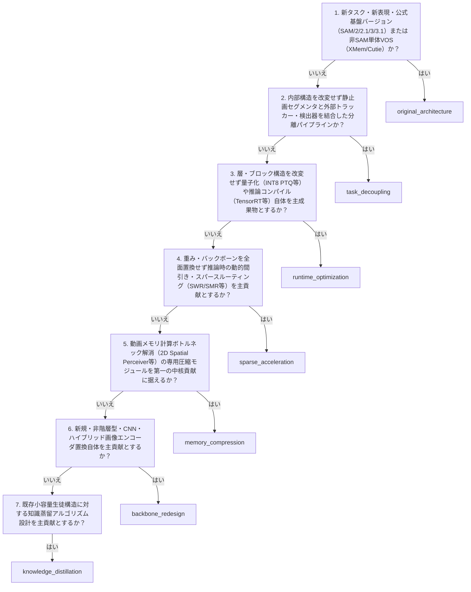

# SAM系および関連動画セグメンテーション・トラッキングモデルの分類定義書

本書は、`data/models.json`（`schema_version: 1.0`）に収録する全26モデルの分類基準を、独立した検証者が機械的かつ再現可能に判定できるように明文化した仕様書である。

---

## 1. 基盤世代ファミリ (`base_family`) の判定規則

各モデルのアーキテクチャ上の原型およびプロンプト／メモリ設計の系統に基づき、以下の4値から排他的に1つを付与する。

| `base_family` | 定義（必要十分条件） | 境界事例・除外条件 |
|---|---|---|
| `sam` | Meta SAM（ViT-H/L/B, arXiv:2304.02643）を教師・蒸留元・互換対象・置換対象とする静止画セグメンテーションモデル、またはSAMを静止画セグメンタとしてパイプラインに組み込む分離型動画追跡システム。 | SAMと構造を共有せずSA-1Bのみで独立学習したモデル（FastSAM, Lite-SAM）であっても、SAMのPoint/Box/SegEveryプロンプト仕様とSA-1B/COCO/LVISのSAM置換ベンチマークを直接の対象とするため `sam` に含める。動画メモリアテンション（SAM 2系）を継承するモデルは除外する。 |
| `sam2` | Meta SAM 2 / SAM 2.1（Hiera + Streaming Memory Bank, arXiv:2408.00714）を原型とし、時系列メモリバンクとプロンプト伝播機構を継承・置換・蒸留・スパース化するモデル。 | SAM 1の静止画エンコーダ置換に外部VOSトラッカー（XMem, DeAOT等）を外付けした分離パイプラインは、SAM 2の統合メモリ機構を持たないため `sam2` ではなく `sam` とする。 |
| `sam3` | Meta SAM 3 / SAM 3.1（Perception Encoder + DETR型検出器 + Presence Head + 動画トラッカー, arXiv:2511.16719）を原型とし、Promptable Concept Segmentation（PCS）とPromptable Visual Segmentation（PVS）を統合する世代。 | Grounding DINOを外部接続してオープン語彙検出を行うSAM 1系分離パイプライン（SAM-Track, DEVA）は `sam3` ではなく `sam` とする。 |
| `non_sam` | SAM系列（SAM / SAM 2 / SAM 3）の重み・デコーダ・プロンプトエンコーダ・蒸留教師・外部呼び出しコンポーネントを一切含まない独立設計の動画オブジェクトセグメンテーション（VOS）モデル（XMem, Cutie）。 | 内部モジュールとしてXMemを利用するTrack-Anything（TAM）はSAMを初期・修正セグメンタとして併用しているため `non_sam` から除外し、`sam` に分類する。 |

---

## 2. パラメータ数 (`params_million`) と `null` 許容条件

- **数値記載条件**: 論文・公式リポジトリ・ベンチマーク表において代表構成の総パラメータ数（100万＝M単位）が単一値として公表・確定している場合、正の数値（例: `636`, `80.8`, `9.66`）を記載し、`params_note` に構成モジュール別の内訳または参照バリアント条件を明記する。
- **`null` 許容条件**: 以下のいずれかに該当する場合は `params_million` を `null` とし、`params_note` に単一値に定まらない具体的理由を明記する。
  1. **外部モデル組合せによる可変性**: 静止画セグメンタ（SAM ViT-H/B/MobileSAM等）と外部トラッカー／点追跡器／テキスト検出器（DeAOT, XMem, E2FGVI, CoTracker/PIPS, Grounding DINO等）を組合せ選択して構成する分離パイプラインであり、選定モジュールにより総パラメータ数が変動する場合（`sam-track`, `track-anything-tam`, `sam-pt`, `deva`）。
  2. **構成依存による未確定**: 公式論文・リポジトリでバックボーン設定等に依存してパラメータ数が変動し（例: `xmem` は ResNet-50 特徴抽出器＋3層メモリ構成で設定により約20〜30M超で変動）、単一の代表総パラメータ数が一次情報で確定していない場合（`xmem`）。

---

## 3. X軸：対応タスク種別 (`task_types`) の分類定義（複数選択可）

各モデルには、以下の5種類のタスクのうち該当するものをすべて配列で付与する（空配列は不可）。判定は「論文または公式リポジトリの一次仕様において、対象タスクが独立した推論モードまたはベンチマーク評価対象として明記されているか」を基準とし、単なる非公式スクリプトでの流用可能性は含めない。

### 3.1 `image_promptable`（静止画プロンプトセグメンテーション）
- **必要十分条件**:
  1. 単一静止画（1フレーム画像）を入力とし、点（クリック）・バウンディングボックス・マスク・テキスト／視覚例示などの空間・概念プロンプトを受け取って対象マスクを予測する単一画像推論パス（`SamPredictor`, `SAM2ImagePredictor`, `Sam3Image`, FastSAM Stage 2 等）を備えること。
  2. かつ、論文または公式ドキュメントにおいて静止画プロンプト推論モード自体が主要機能または評価対象（SA-1B / SA-23 / SA-1K / COCO / LVIS / SA-Co 等）として明記されていること（SAM 2/3系のように1フレーム動画として静止画推論を統合処理するモデルを含む）。
- **除外条件（境界事例の扱い）**:
  - **純粋な動画マスク伝播モデル**（`xmem`, `cutie`）は静止画プロンプトからのマスク生成機能を持たないため付与しない。
  - **分離型動画追跡パイプライン**（`sam-track`, `track-anything-tam`, `sam-pt`, `deva`）は内部コンポーネントとして静止画セグメンタSAMを呼び出すが、システム全体の入出力仕様および論文評価ベンチマーク（DAVIS, YouTube-VOS, MOSE, UVO 等）が動画フレーム列の連続追跡に限定されているため `image_promptable` は付与しない。
  - **時間連続性依存の動画推論演算削減**（`efficient-sam2`）は、提案手法である SWR（前フレームのデコーダ顕著性手がかりを利用）および SMR（時系列メモリバンクから顕著トークンを取得）が複数フレーム間の時間情報にのみ作用し、1フレーム静止画推論では元のSAM 2.1-Lと同一計算になるため `image_promptable` から除外する。

### 3.2 `image_automatic`（静止画全自動抽出 / SegEvery）
- **必要十分条件**:
  以下のいずれかを満たすこと。
  1. 個別の空間・テキストプロンプトをユーザーから受け取らずに、画像内の全インスタンス候補を自動抽出する専用アーキテクチャまたは専用推論アルゴリズム（例: SAMのグリッド点群サンプリング＋NMS／安定性フィルタとSA-1B自動生成、FastSAM Stage 1 のYOLOv8-seg全インスタンス一括抽出、Lite-SAM の AutoPPN による自動プロンプト提案、TinySAM の階層的 Segment Everything 戦略）を論文で提案または主要評価対象としてベンチマークしていること。
- **除外条件（境界事例の扱い）**:
  - **SAMデコーダ互換のグリッド点投入ラッパー継承のみ**: 論文が主に空間プロンプト（点・ボックス）推論（SegAny / PVS）を設計・評価しており、コード上に `SamAutomaticMaskGenerator` / `SAM2AutomaticMaskGenerator` 相当の汎用グリッド推論ラッパーが存在するに過ぎない派生物（`mobilesam`, `edgesam`, `efficientsam-vit-s`, `efficientvit-sam-l0`, `repvit-sam`, `nanosam`, `sam2-hiera-b-plus`, `sam2-1-hiera-b-plus`, `efficienttam-vit-ti`, `efficienttam-vit-s`, `edgetam`, `mobilesam2`）には付与しない。
  - **Q-TinySAMの扱い**: `q-tinysam` は TinySAM 論文（arXiv:2312.13789）Section 3.2 においてプロンプト可能セグメンテーション向けにHessian指標に基づくINT8事後学習量子化（PTQ）を適用・評価（Table 1 の61 ms/画像および COCO zero-shot AP 41.4%）したモデルであり、Section 3.3 の階層的 Segment Everything 評価は量子化前の `tinysam` を主体とするため、`tinysam` に `image_automatic` を付与し `q-tinysam` には付与しない。
  - **概念プロンプト必須型**: `sam3`, `sam3-1` の PCS は名詞句テキストや視覚例示という概念プロンプトの入力を必須とするため、プロンプト不要の全抽出である `image_automatic` には含めない。

### 3.3 `video_semi_supervised`（動画Semi-Supervised VOS）
- **必要十分条件**:
  動画シーケンスの第0フレーム（初期フレーム）に与えられた正解マスク、または初期フレームにおける点・テキスト等の初期指示から生成されたマスクを起点として、後続の動画フレーム全体へオブジェクトマスクを自動伝播できる機能・評価ベンチマーク（DAVIS 2016/2017, YouTube-VOS, MOSE, LVOS, SA-V 等）を備えていること。
- **除外条件（境界事例の扱い）**:
  - 単一静止画のみを対象とし、フレーム間伝播機構（メモリバンク、双方向伝播、点追跡器等）を持たないモデル（`sam-vit-h`, `mobilesam`, `edgesam`, `efficientsam-vit-s`, `efficientvit-sam-l0`, `repvit-sam`, `nanosam`, `tinysam`, `q-tinysam`, `fastsam`, `lite-sam`）には付与しない。
  - SAM 2/3系・TAM系のように対話的修正にも対応するモデルであっても、初期フレームマスクからの自動伝播（Semi-Supervised VOS設定）を仕様・ベンチマークに含む場合は本タスクを重複付与する。

### 3.4 `video_promptable`（動画対話型プロンプトセグメンテーション）
- **必要十分条件**:
  動画内の任意の複数フレーム（初期フレームだけでなく中間フレームを含む）において、点（クリック）・バウンディングボックス・マスク等の追加または修正プロンプトをインタラクティブに入力し、そのプロンプトまたは修正結果を時系列メモリ機構や対話的追跡ループに組み込んで前後フレームへ伝播・更新できるモデルであること（SAM 2/3系の Promptable Visual Segmentation 仕様、または任意フレームでのSAM対話クリック修正とXMem再伝播を統合した Track-Anything の対話追跡ループ）。
- **除外条件（境界事例の扱い）**:
  - **初期フレームマスク専用VOS**: 初期フレームのマスク入力のみを前提とし、モデル単体として任意フレームでの点・ボックス対話プロンプトとメモリ修正ループを持たない純粋な Semi-Supervised VOS モデル（`xmem`, `cutie`）には付与しない。
  - **初期点群の前方向追跡特化**: 初期フレームで設定・抽出した点群を CoTracker/PIPS 等の点追跡器で前方向追跡して毎フレームSAMデコードを行う設計であり、PVS形式の任意中間フレームへの時系列メモリ修正プロトコル・評価を持たないパイプライン（`sam-pt`）には付与しない。
  - **キーフレーム結合・半オンライン融合パイプライン**: キーフレーム単位で静止画セグメンタ（SAM / Grounding DINO）の独立出力を生成し、DeAOT の一方向伝播や DEVA の半オンライン仮説融合へ受け渡す構成であり、SAM 2系PVSやTrack-Anythingのような「任意フレームでの同一対象マスクの対話的クリック修正と再伝播」を主評価モードとして持たないパイプライン（`sam-track`, `deva`）には付与しない。

### 3.5 `video_open_vocabulary`（動画オープン語彙・テキスト指定追跡）
- **必要十分条件**:
  任意の自然言語名詞句・テキストプロンプト（またはテキスト＋視覚例示）を入力として受け取り、事前定義された固定クラス集合に限定されずに動画内の対応インスタンスを検出・セグメンテーションし、複数フレーム間で継続追跡できること（SAM 3/3.1 の Perception Encoder + DETR型検出器による PCS、または Grounding DINO をパイプライン統合した SAM-Track / DEVA）。
- **除外条件（境界事例の扱い）**:
  - 点・ボックス・マスク等の幾何的空間プロンプトのみを受け付け、自然言語テキストによる動画内オープン語彙検出機能を持たないモデル（SAM 2 / 2.1, EfficientTAM, EdgeTAM, MobileSAM2, Efficient-SAM2, Track-Anything, SAM-PT, XMem, Cutie）には付与しない。
  - 静止画専用モデル（FastSAM等）は動画追跡を行わないため対象外とする。

### 3.6 タスク境界対照表

| モデル群 | `image_promptable` | `image_automatic` | `video_semi_supervised` | `video_promptable` | `video_open_vocabulary` |
|---|---|---|---|---|---|
| `sam-vit-h`, `tinysam`, `fastsam`, `lite-sam` | 該当 | 該当 | 非該当 | 非該当 | 非該当 |
| `mobilesam`, `edgesam`, `efficientsam-vit-s`, `efficientvit-sam-l0`, `repvit-sam`, `nanosam`, `q-tinysam` | 該当 | 非該当 | 非該当 | 非該当 | 非該当 |
| `sam2-hiera-b-plus`, `sam2-1-hiera-b-plus`, `efficienttam-vit-ti`, `efficienttam-vit-s`, `edgetam`, `mobilesam2` | 該当 | 非該当 | 該当 | 該当 | 非該当 |
| `efficient-sam2` | 非該当 | 非該当 | 該当 | 該当 | 非該当 |
| `sam3`, `sam3-1` | 該当 | 非該当 | 該当 | 該当 | 該当 |
| `track-anything-tam` | 非該当 | 非該当 | 該当 | 該当 | 非該当 |
| `sam-track`, `deva` | 非該当 | 非該当 | 該当 | 非該当 | 該当 |
| `sam-pt`, `xmem`, `cutie` | 非該当 | 非該当 | 該当 | 非該当 | 非該当 |

---

## 4. Y軸：最適化アプローチ (`optimization_method` / `optimization_methods_secondary`) の分類定義

### 4.1 主分類を一意に決定するための優先順位（タイブレーク規則）

複数の最適化手法を併用するモデルに対し、主分類（`optimization_method`）を一意に決定するため、以下の**ステップ1からステップ7の優先順位**に従って上から順に判定し、**最初に条件を満たした分類**を主分類とする。

### 4.2 副分類 (`optimization_methods_secondary`) の付与規則

- 各モデルが、その `base_family` の基盤原型（または SAM 3.1 のように直前基盤からの追加機構）に対して**実際にアーキテクチャ・学習・推論パイプライン上で内包している最適化要素**のうち、主分類（`optimization_method`）に選ばれなかった手法IDをすべて `optimization_methods_secondary` に格納する（主分類と重複させない）。
- **副分類における `runtime_optimization` の除外境界**: 単なるベンチマーク測定手段として既存モデルを標準の CoreML / ONNX に変換してスマートフォン等でFPS計測を行ったに過ぎないモデル（EdgeSAM, RepViT-SAM, EfficientTAM, EdgeTAM 等）には付与せず、TensorRT FP16/INT8 エンジン構築・推論スループット最適化を論文・公式実装の主要要素（Table 1 や専用デプロイ機構）として組み込んでいる場合（例: `efficientvit-sam-l0`）にのみ副分類として付与する。
- **副分類における `memory_compression` と `sparse_acceleration` の区別**: メモリトークン数・空間解像度・複数物体状態を構造的に圧縮・集約するモジュール（2D Spatial Perceiver、ウィンドウプーリング、Object Multiplex）は `memory_compression` とし、メモリ表現の形式を変えずに推論時のサリエンシーキューで参照トークンを動的選択する機構（SMR）は `sparse_acceleration` として扱い、`memory_compression` には含めない。

---

### 4.3 各最適化手法の必要十分条件と除外条件

#### (1) `original_architecture`（基盤・独自アーキテクチャ）［優先順位 1］
- **必要十分条件**:
  既存モデル群のパラメータ数や演算量を削減するパラメータ数削減派生・推論遅延短縮派生ではなく、以下のいずれかに該当するモデル。
  - (a) 新たなタスク定式化・学習データエンジン・表現学習を導入した公式基盤モデルまたはその公式基盤アップデート版（`sam-vit-h`, `sam2-hiera-b-plus`, `sam2-1-hiera-b-plus`, `sam3`, `sam3-1`）。
  - (b) SAM系コンポーネントに依存せず、独自の動画メモリ構造で設計・学習された非SAM系VOS単体モデル（`xmem`: Atkinson-Shiffrin 3層メモリ、`cutie`: Query-based Object Transformer `qt`）。
- **除外条件**:
  公式基盤モデルの計算量削減やオンデバイス実行を目的として外部研究機関・派生プロジェクトにより提案された派生モデル（EfficientTAM, EdgeTAM, MobileSAM系, Efficient-SAM2 等）は除外する。なお、`sam3-1` は SAM 3 の公式基盤アップデートであるため主分類を `original_architecture` とし、追加機構 Object Multiplex に対応する `memory_compression` を副分類に付与する。

#### (2) `task_decoupling`（タスク分離パイプライン結合）［優先順位 2］
- **必要十分条件**:
  静止画セグメンタ（SAM等）の内部ネットワーク構造・重みを改変または再蒸留することなく、独立して学習された外部の動画マスク伝播器（DeAOT, XMem）、動画補完器（E2FGVI）、点追跡器（CoTracker, PIPS）、オープン語彙物体検出器（Grounding DINO）、あるいはタスク非依存の双方向伝播融合モジュール（DEVA）を推論パイプライン上で結合し、動画セグメンテーション・追跡を実現するシステム（`sam-track`, `track-anything-tam`, `sam-pt`, `deva`）。
- **除外条件**:
  - 単一の統合モデルとして学習された画像・動画統合アーキテクチャ（SAM 2, SAM 3, EfficientTAM, EdgeTAM, MobileSAM2）は除外する。
  - 単一のCNNインスタンス検出器（YOLOv8-seg）の推論内部で「全インスタンス生成→プロンプトによる選択」の2段階処理を行う `fastsam` は、複数独立モデルのパイプライン結合ではないため除外する（`backbone_redesign` に分類）。

#### (3) `runtime_optimization`（推論量子化・ランタイム最適化）［優先順位 3］
- **必要十分条件**:
  学習済みモデルの層・ブロック構成（エンコーダ／デコーダ構造自体）を新たに設計・改変することなく、既存モデル重みまたは蒸留構成に対する**量子化手順（例: `q-tinysam` のタスク特化Hessian誘導INT8事後学習量子化 PTQ）**または**推論エンジン向けコンパイル最適化実装（例: `nanosam` の NVIDIA Jetson Orin 向け TensorRT FP16/INT8 エンジン変換と実行パイプライン）**自体を主成果物とするモデル・プロジェクト。
- **除外条件**:
  エンコーダ再設計や新規知識蒸留アルゴリズムを主論文貢献とし、推論コンパイル（TensorRT FP16 等）をデプロイ検証・スループット向上の一部として併用するモデル（例: `efficientvit-sam-l0`）はステップ6（`backbone_redesign`）を主分類とし、本分類は副分類に留める。単に CoreML 等でモバイルFPSを計測しただけのモデルには主・副とも付与しない。

#### (4) `sparse_acceleration`（推論時スパース計算・動的間引き）［優先順位 4］
- **必要十分条件**:
  学習済み基盤モデル（例: SAM 2.1-L の `224.4M` 重み）のバックボーン構造や重みを全面置換せず、推論時におけるフレーム間の時間連続性・空間顕著性に基づいて演算領域やメモリ参照トークンを**動的に間引き・ショートカットルーティングする機構**（例: `efficient-sam2` における前フレームのデコーダ顕著性を用いた画像エンコーダ用 SWR［Sparse Window Routing］および FIFO顕著性マスクキューを用いたメモリアテンション用 SMR［Sparse Memory Retrieval］）を主貢献とする手法。
- **除外条件**:
  - 入力画像全体に対して固定の空間ウィンドウプーリングや学習可能クエリによるメモリ表現の次元・トークン数圧縮を行う手法（EdgeTAM, EfficientTAM）は、動的間引きではなく構造的圧縮であるため `memory_compression` とする。
  - 静的階層グリッドサンプリングによるプロンプト候補削減（TinySAM の Hierarchical Segment Everything）は特徴抽出・メモリ計算の動的スパースルーティングではないため除外する。

#### (5) `memory_compression`（動画メモリ構造圧縮）［優先順位 5］
- **必要十分条件**:
  動画セグメンテーションにおける時系列メモリクロスアテンション等の計算ボトルネック解消を論文の中核課題に据え、密なフレーム単位のメモリ特徴を固定個の学習可能クエリや空間縮約表現へ**構造的に圧縮・集約する専用モジュール**（例: `edgetam` におけるグローバルレベルとパッチレベルの学習可能クエリでメモリ表現を圧縮する `2D Spatial Perceiver`）を設計し、論文の第一の中核貢献として提示しているモデル。
- **除外条件**:
  - 動画メモリ機構を持たない静止画専用モデルには該当しない。
  - メモリモジュール内でウィンドウプーリングによるトークン縮約を行っていても、論文の第一の中核貢献が Hiera から非階層型 ViT-Ti/S への画像エンコーダ再設計にあるモデル（`efficienttam-vit-ti`, `efficienttam-vit-s`）はステップ6（`backbone_redesign`）を主分類とし、`memory_compression` は副分類として付与する。
  - 基盤モデルの公式バージョンアップとして Object Multiplex を追加した `sam3-1` はステップ1（`original_architecture`）を主分類とし、`memory_compression` を副分類とする。
  - メモリトークン表現を改変せず参照時にトークンを間引く `efficient-sam2`（SMR）はステップ4（`sparse_acceleration`）とする。

#### (6) `backbone_redesign`（画像エンコーダ構造再設計）［優先順位 6］
- **必要十分条件**:
  SAMの ViT-H または SAM 2 の階層型 Hiera 画像エンコーダを、異なる演算構造・容量を持つバックボーンへ置換・再設計すること自体を論文のアーキテクチャ上の主貢献とするモデル。具体的には以下のいずれかを満たすこと。
  - (a) 論文が小パラメータ容量・低MACsのバックボーン・ハイブリッド構造・線形アテンション構造・CNN検出器構造を提案またはSAM系へ新規導入し、そのバックボーン構造特性を主貢献としている（`efficientvit-sam-l0`: Multi-Scale ReLU線形アテンション型 EfficientViT-L0、`repvit-sam`: MobileNetV3をViT設計視点で再構成した純CNN型 RepViT-M0.9、`fastsam`: YOLOv8-x seg CNN検出器、`lite-sam`: 1.16M CNN-Transformerハイブリッド LiteViT + AutoPPN）。
  - (b) 階層型エンコーダ（Hiera）を非階層型プレーンViT（ViT-Ti / ViT-S）へ置換し、SA-1BおよびSA-Vで再構築・学習している（`efficienttam-vit-ti`, `efficienttam-vit-s`）。
  - (c) MAE型マスク画像特徴再構成事前学習（SAMI）を用いて汎用 ViT-Small / ViT-Tiny バックボーンをSAM互換エンコーダとして再構築し、SA-1Bでデコーダと統合ファインチューニングするバックボーン転換設計を主貢献としている（`efficientsam-vit-s`）。
- **除外条件**:
  - 既に別研究で確立された小容量バックボーン構造（TinyViT や既知の RepViT 等）を生徒ネットワークとして用い、教師から生徒への**知識蒸留アルゴリズムの設計自体**を主論文タイトル・中核貢献とするモデル（`mobilesam`, `edgesam`, `tinysam`, `mobilesam2`）はステップ7（`knowledge_distillation`）を主分類とし、バックボーン置換は副分類（`optimization_methods_secondary`）として扱う。

#### (7) `knowledge_distillation`（知識蒸留アルゴリズム設計）［優先順位 7］
- **必要十分条件**:
  既存の小容量生徒アーキテクチャ（TinyViT 約5M、純CNN系 RepViT 派生、探索済み小容量SAM 2生徒構造等）に対し、教師モデル（SAM ViT-H または SAM 2）の表現や対話的応答の再現誤差を抑えて転移するための**知識蒸留アルゴリズムおよび損失関数設計**を主貢献とするモデル。
  - `mobilesam`: エンコーダとマスクデコーダの結合最適化による困難を回避し画像エンコーダのみを独立蒸留する **Decoupled Distillation**。
  - `edgesam`: 蒸留ループ内にプロンプトエンコーダとマスクデコーダ（点・ボックスプロンプト）を組み込む **Prompt-in-the-Loop Distillation**。
  - `tinysam`: オンライン困難プロンプトサンプリングと困難マスク重み付けを行う **Hard-Mining Full-Stage Knowledge Distillation**。
  - `mobilesam2`: 時間相関と多粒度空間手がかりをハイパーグラフで転移する **HyperKD（Temporal HyperKD + Granularity HyperKD）**。
- **除外条件**:
  - 知識蒸留を一切使わずSA-1BやSA-Vで直接学習・事前学習を行うモデル（`fastsam`, `lite-sam`, `efficienttam-vit-ti`, `efficienttam-vit-s`）には主・副とも付与しない。
  - 蒸留手法を援用していても、ステップ3〜6で定義されたランタイム最適化（`nanosam`, `q-tinysam`）、スパース計算による演算間引き、メモリ構造圧縮（`edgetam`）、またはバックボーン新規設計・再構築（`efficientsam-vit-s`, `efficientvit-sam-l0`, `repvit-sam`）が優先条件を満たす場合は、そちらを主分類とし本分類は副分類とする。

---

## 5. 全26モデルの分類対応一覧（監査用リファレンス）

| ID | モデル名 | `base_family` | `params_million` | `optimization_method` (主) | `optimization_methods_secondary` (副) | `task_types` |
|---|---|---|---|---|---|---|
| `sam-vit-h` | SAM (ViT-H) | `sam` | `636` | `original_architecture` | `[]` | `image_promptable`, `image_automatic` |
| `sam2-hiera-b-plus` | SAM 2 (Hiera-B+) | `sam2` | `80.8` | `original_architecture` | `[]` | `image_promptable`, `video_semi_supervised`, `video_promptable` |
| `sam2-1-hiera-b-plus` | SAM 2.1 (Hiera-B+) | `sam2` | `80.8` | `original_architecture` | `[]` | `image_promptable`, `video_semi_supervised`, `video_promptable` |
| `sam3` | SAM 3 | `sam3` | `848` | `original_architecture` | `[]` | `image_promptable`, `video_semi_supervised`, `video_promptable`, `video_open_vocabulary` |
| `sam3-1` | SAM 3.1 | `sam3` | `848` | `original_architecture` | `memory_compression` | `image_promptable`, `video_semi_supervised`, `video_promptable`, `video_open_vocabulary` |
| `mobilesam` | MobileSAM | `sam` | `9.66` | `knowledge_distillation` | `backbone_redesign` | `image_promptable` |
| `edgesam` | EdgeSAM | `sam` | `9.6` | `knowledge_distillation` | `backbone_redesign` | `image_promptable` |
| `efficientsam-vit-s` | EfficientSAM (ViT-S) | `sam` | `25` | `backbone_redesign` | `knowledge_distillation` | `image_promptable` |
| `efficientvit-sam-l0` | EfficientViT-SAM (L0) | `sam` | `34.8` | `backbone_redesign` | `knowledge_distillation`, `runtime_optimization` | `image_promptable` |
| `repvit-sam` | RepViT-SAM | `sam` | `5.1` | `backbone_redesign` | `knowledge_distillation` | `image_promptable` |
| `nanosam` | NanoSAM | `sam` | `15.5` | `runtime_optimization` | `backbone_redesign`, `knowledge_distillation` | `image_promptable` |
| `tinysam` | TinySAM | `sam` | `10.5` | `knowledge_distillation` | `backbone_redesign` | `image_promptable`, `image_automatic` |
| `q-tinysam` | Q-TinySAM | `sam` | `10.5` | `runtime_optimization` | `knowledge_distillation`, `backbone_redesign` | `image_promptable` |
| `fastsam` | FastSAM (FastSAM-x) | `sam` | `68` | `backbone_redesign` | `[]` | `image_promptable`, `image_automatic` |
| `lite-sam` | Lite-SAM | `sam` | `4.2` | `backbone_redesign` | `[]` | `image_promptable`, `image_automatic` |
| `efficienttam-vit-ti` | EfficientTAM (ViT-Ti) | `sam2` | `18` | `backbone_redesign` | `memory_compression` | `image_promptable`, `video_semi_supervised`, `video_promptable` |
| `efficienttam-vit-s` | EfficientTAM (ViT-S) | `sam2` | `34` | `backbone_redesign` | `memory_compression` | `image_promptable`, `video_semi_supervised`, `video_promptable` |
| `edgetam` | EdgeTAM | `sam2` | `16` | `memory_compression` | `backbone_redesign`, `knowledge_distillation` | `image_promptable`, `video_semi_supervised`, `video_promptable` |
| `mobilesam2` | MobileSAM2 (23M) | `sam2` | `23.7` | `knowledge_distillation` | `backbone_redesign` | `image_promptable`, `video_semi_supervised`, `video_promptable` |
| `efficient-sam2` | Efficient-SAM2 | `sam2` | `224.4` | `sparse_acceleration` | `[]` | `video_semi_supervised`, `video_promptable` |
| `sam-track` | SAM-Track | `sam` | `null` | `task_decoupling` | `[]` | `video_semi_supervised`, `video_open_vocabulary` |
| `track-anything-tam` | Track-Anything (TAM) | `sam` | `null` | `task_decoupling` | `[]` | `video_semi_supervised`, `video_promptable` |
| `sam-pt` | SAM-PT | `sam` | `null` | `task_decoupling` | `[]` | `video_semi_supervised` |
| `deva` | DEVA | `sam` | `null` | `task_decoupling` | `[]` | `video_semi_supervised`, `video_open_vocabulary` |
| `xmem` | XMem | `non_sam` | `null` | `original_architecture` | `[]` | `video_semi_supervised` |
| `cutie` | Cutie | `non_sam` | `39.4` | `original_architecture` | `[]` | `video_semi_supervised` |

## 6. 派生・関連実装の追記

モデル数とバブル図は `models` を集計する。個別の重み、実装、端末向け変換、配布ミラーは `derivatives` に1件ずつ登録する。
`id` は全モデル・派生を通じて一意の固定ID、`parent_ids` は系統図でたどる元モデル・元ファイル・配布元のIDとする。複数の親から同じ成果物を参照できる。
モデル系列までしか特定できない実装には該当系列の親IDと `group`（例「EfficientTAM共通」）を指定し、対応を確認できた個別ファイルは説明に記す。

各項目には表示名 `name`、種類 `kind`、重みの扱い `weights`、変更点 `description`、一次資料の `sources`（label・HTTPS URL）、確認日 `checked_on`（YYYY-MM-DD）を記録する。
性能値には測定元・端末・入力サイズ・演算精度を添え、不明な条件は未確認と明記する。
コミュニティの議論と件数は `communities` に対象の `model_ids`、説明、出典、確認日を記録し、件数を再確認した際に日付も更新する。
